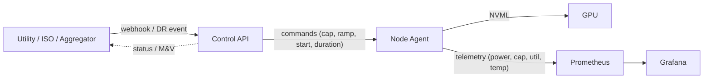

# Grene Protocol

Make a single GPU behave like a **dispatchable load** for the grid.
This MVP lets an external party (e.g., a DR aggregator) call a **/dispatch** webhook, and your **node agent** safely throttles the GPU (via NVML power caps) with ramps, telemetry, and auto-restore. A small dashboard shows what happened in real time.

> ⚠️ Requires root on the GPU host and an NVIDIA GPU that supports **power management limits**.

---

## What you get

* **Control API**: receives signed DR events → translates to per-GPU setpoints → tracks state & M&V.
* **Node Agent (systemd)**: runs on the GPU host, applies power caps & streams telemetry.
* **Metrics & M&V**: Prometheus metrics + a simple event report (baseline vs actual, delivered kW).
* **Demo flow**: `POST /dispatch` → ramp to cap → hold → auto-restore → download M&V CSV.

---

## Quick start (10–15 minutes)

1. **Verify your GPU supports capping**

```bash
nvidia-smi -q -d POWER | egrep -i 'Power Management|Default Power Limit|Min Power Limit|Max Power Limit'
sudo nvidia-smi -pm 1   # enable persistence mode
nvidia-smi --query-gpu=power.limit,power.default_limit --format=csv
```

If **Power Management: Supported** and you see **Min/Max Power Limit**, you’re good.

2. **Run a steady GPU load** (to make the cap “bite”)
   Use any inference loop, `gpu-burn`, etc.

3. **Start the Control API** (binds on `:8080` by default)

4. **Install & start the Node Agent (systemd, root)**
   The agent will register with Control, report capabilities (min/max cap), and begin telemetry.

5. **Trigger a dispatch (event starts in 30s, ramps 60s, holds 10m)**

```bash
ts=$(date -u +"%Y-%m-%dT%H:%M:%SZ" -d "+30 seconds")
cat > body.json <<'EOF'
{
  "event_id": "evt_demo_001",
  "program": "NYISO_DR_PILOT",
  "site_id": "site_local_01",
  "start_at": "__START_AT__",
  "duration_s": 600,
  "target_cap_w": 160,
  "ramp_s": 60,
  "reason": "system_peak"
}
EOF
# Replace start time
sed -i'' "s/__START_AT__/$ts/g" body.json

# Sign the request (HMAC-SHA256 over "<timestamp>.<body>"), then send:
TS=$(date -u +"%Y-%m-%dT%H:%M:%SZ")
SIG=$(printf "%s.%s" "$TS" "$(cat body.json)" | openssl dgst -sha256 -hmac "$HMAC_SECRET" -binary | base64)

curl -sS -X POST http://CONTROL_HOST:8080/dispatch \
  -H "Content-Type: application/json" \
  -H "X-Dispatch-Timestamp: $TS" \
  -H "X-Dispatch-Signature: $SIG" \
  --data @body.json
```

6. **Observe**

* Power draw trends to **~160 W** within the 60s ramp.
* After 10m, agent **auto-restores** to the prior limit.
* Query status: `GET /events/evt_demo_001`
* Scrape metrics: `GET /metrics` (Prometheus format)

---

## Architecture




---

## Components

### Control API (central brain)

* **Endpoints**

  * `POST /dispatch` — receive signed DR events.
  * `GET /events/:id` — live status + M&V snapshot.
  * `GET /metrics` — Prometheus metrics.
  * `GET /health` — liveness.
* **Responsibilities**

  * Verify **HMAC** signature & timestamp freshness.
  * Translate event → **target_cap_w** (+ clamp to device bounds).
  * Send setpoint/ramp to agent; track state machine & timeouts.
  * Compute **baseline vs actual** and **delivered kW** for M&V.
  * Persist events/samples/audit in **SQLite**.

### Node Agent (systemd, root)

* **Responsibilities**

  * Discover GPU (UUID, min/max cap), record current cap.
  * Apply **linear ramp** to target cap; hold for duration; restore.
  * Stream 1–2s **telemetry** (power_w, cap_w, util%, temp_c, pstate, throttle_flags).
  * **Failsafe:** safe restore if heartbeat lost or errors occur.
* **Local endpoints**

  * `GET /metrics` (Prometheus).
  * `GET /healthz`, `GET /state` (debug snapshot).

---

## Configuration

### Control API (`.env` or flags)

* `BIND_ADDR` (default `:8080`)
* `HMAC_SECRET` (required)
* `DB_PATH` (SQLite path, default `./control.db`)
* `AGENT_TOKEN` or mTLS certs for agent auth
* `SITE_ID` (label in metrics/M&V)
* `GPU_RATED_POWER_W` (for kW ↔ W conversions if using `target_curtail_kw`)

### Node Agent (`/etc/compute-agent/config.yaml`)

* `control_url: https://control.example.com:8080`
* `auth_token: "..."` (or mTLS client certs)
* `gpu_selector: { uuid: "..."} # or { index: 0 }`
* `min_cap_w: 120` | `max_cap_w: 300` (optional clamps; auto-read from NVML anyway)
* `sample_interval_s: 1`
* `heartbeat_interval_s: 5`
* `restore_on_exit: true`
* `ramp_step_s: 1` (ramp tick)
* `timeout_s: 90` (no heartbeat ⇒ restore)

---

## API contracts (MVP)

### `POST /dispatch` (Control API)

Headers:

* `X-Dispatch-Timestamp: 2025-09-06T17:30:00Z`
* `X-Dispatch-Signature: base64(hmac_sha256(secret, "<timestamp>.<body>"))`

Body (choose **one** of `target_cap_w` or `target_curtail_kw`):

```json
{
  "event_id": "evt_123",
  "program": "NYISO_DR_PILOT",
  "site_id": "site_nyc_01",
  "start_at": "2025-09-06T17:30:00Z",
  "duration_s": 1800,
  "ramp_s": 60,
  "target_cap_w": 160,
  "reason": "system_peak",
  "notes": "demo"
}
```

### Command to Agent (conceptual)

```json
{
  "event_id": "evt_123",
  "start_at": "2025-09-06T17:30:00Z",
  "duration_s": 1800,
  "ramp_s": 60,
  "target_cap_w": 160
}
```

### Telemetry from Agent → Control (example sample)

```json
{
  "node": "node-01",
  "gpu_uuid": "GPU-XXXX",
  "ts": "2025-09-06T17:30:45Z",
  "power_w": 171.4,
  "power_cap_w": 180,
  "util_percent": 87,
  "temp_c": 66,
  "pstate": "P2",
  "throttle_flags": ["SW_POWER_CAP"],
  "event_state": "RAMPING",
  "event_id": "evt_123"
}
```

---

## M&V (Measurement & Verification)

* **Baseline (W):** trailing **10-minute** average power before `start_at`.
* **Actual (W):** average power during the event window.
* **Delivered (kW):** `max(0, (Baseline - Actual) / 1000)`.
* **Response time (s):** (command accepted → first downward power movement) and (command → cap reached).
* Export a CSV per event with columns:

  * `ts,power_w,cap_w,util_percent,temp_c,event_state`
  * Footer: `baseline_w,actual_w,delivered_kw,response_first_s,response_full_s`

---

## Prometheus metrics (names & labels)

**Agent**

* `gpu_power_watts{node,gpu_uuid}`
* `gpu_power_cap_watts{node,gpu_uuid}`
* `gpu_utilization_percent{node,gpu_uuid}`
* `gpu_temperature_celsius{node,gpu_uuid}`
* `gpu_event_state{node,gpu_uuid,event_id}` (0 idle, 1 pending, 2 ramping, 3 holding, 4 restoring)
* `gpu_nvml_last_rc{node,gpu_uuid}` (0 ok, otherwise last NVML error code)

**Control**

* `control_event_active{event_id,site_id}` (0/1)
* `control_event_target_cap_watts{event_id,site_id}`
* `control_event_delivered_kw{event_id,site_id}`
* `control_event_response_seconds{event_id,kind="first|full"}`
* `control_api_requests_total{route,code}`
* `control_api_signature_fail_total`
* `control_agent_heartbeats{node}`

---

## Systemd (Node Agent)

`/etc/systemd/system/compute-agent.service`

```ini
[Unit]
Description=Compute DR Node Agent
After=network-online.target
Wants=network-online.target

[Service]
Type=simple
User=root
ExecStart=/usr/local/bin/compute-agent --config /etc/compute-agent/config.yaml
Restart=always
RestartSec=2
# Needs NVML access; if running in a container, use --privileged + NVIDIA runtime.

[Install]
WantedBy=multi-user.target
```

Enable & run:

```bash
sudo systemctl daemon-reload
sudo systemctl enable --now compute-agent
journalctl -u compute-agent -f
```

---

## Acceptance criteria (for your demo)

* **Cap works:** During a dispatch, GPU power follows the **ramp → target cap** within tolerance.
* **Auto-restore:** After `duration_s`, previous cap is restored even if Control is down.
* **M&V available:** `GET /events/:id` shows baseline, actual, delivered kW, response times; CSV downloadable.
* **Observability:** Prometheus shows a continuous trace; Grafana panels visualize Power vs Cap with event overlays.

---

## Safety & limits

* Agent clamps `target_cap_w` to NVML **min/max**.
* If NVML errors or heartbeat loss > `timeout_s`, agent **SAFE_RESTORE** and reports error.
* Consumer GPUs or laptops may not support `-pl`; use clock-lock fallback only if explicitly enabled.
* Running as root is required to change power limits—keep the agent small and auditable.

---

## Troubleshooting

* **“Power Management: Not Supported”** → Your GPU/driver blocks capping. Use a server GPU or enable clock-lock fallback.
* **“Insufficient Permissions”** → Run agent as root; if containerized, add `--privileged` and NVIDIA runtime.
* **Power doesn’t drop** → Ensure a steady load; otherwise the cap might not bind (idle GPU will draw below the cap).
* **Erratic power** → Increase ramp time; optionally lock clocks to stabilize near the cap.

---

## Roadmap (post-MVP)

* OpenADR VEN client in Control to receive real DR signals.
* Price- or carbon-aware dispatch (NYISO DA/RT, grid intensity).
* HPC integrations (Slurm Prolog/Epilog or SPANK).
* Multi-GPU/node orchestration and priority policies.

---


