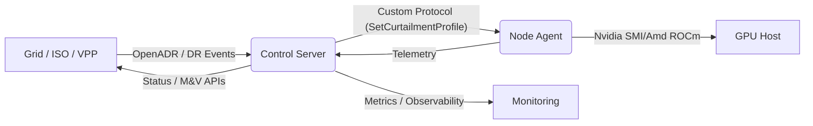

# Grene Protocol

Grene is a prototype control plane for treating GPUs as dispatchable electrical loads. A control
server speaks a lightweight "Open Compute Protocol" (OCP) over websockets with agents running next to
GPUs. Dispatch commands lower a GPU power cap, the agent ramps and holds the new limit, publishes
telemetry, and restores the previous setting when the event ends or errors occur.

---

## What works today

- **Control server (`./cmd/server`)**
  - Serves REST `POST /v1/control/dispatch` for issuing curtailment events.
  - Hosts the agent websocket at `GET /v1/agent/subscribe`.
  - Fans out OCP messages (`SetCurtailmentProfile`, `Telemetry`, `StatusNotification`, `Heartbeat`).
  - Logs every incoming/outgoing frame with optional pretty/JSON output.

- **Node agent (`./cmd/agent`)**
  - Connects to the server websocket and registers its node name.
  - Accepts curtailment profiles with start, end, ramp seconds, and target cap watts.
  - Applies linear ramps to the GPU power limit via `nvidia-smi -pl` (or a mock driver).
  - Streams telemetry (power draw, power cap, utilization %, temperature °C, event metadata).
  - Sends periodic heartbeats and status transitions; auto-restores on completion or failure.
  - Detailed ramp logging to show every intermediate setpoint.

- **Mock GPU mode** (`-mock-gpu`)
  - Lets you run the entire flow without `nvidia-smi` by simulating power limits and telemetry.

What’s intentionally *not* here yet: authentication, dashboards, Prometheus/M&V storage, signed
dispatches, systemd packaging, or multi-node orchestration. The README focuses on the pieces that
already exist in this repository.

---

## Repository tour

```
cmd/server/      Control server entrypoint
cmd/agent/       Node agent entrypoint
ocp/             Message types and helpers for the OCP wire protocol
ws/              Websocket hub used by the server
server/          HTTP server wiring and configuration
```

---

## Prerequisites

- Go 1.21+
- Git and Make (optional, but `make build` is convenient)
- For real hardware testing: an NVIDIA GPU with power management limits exposed via `nvidia-smi`
  and root privileges to adjust power caps.

Recommended checks on a GPU host:

```bash
nvidia-smi -q -d POWER | egrep -i 'Power Management|Power Limit'
sudo nvidia-smi -pm 1              # enable persistence mode
nvidia-smi --query-gpu=power.limit,power.min_limit,power.max_limit --format=csv
```

---

## Quick start (mock GPU)

```bash
# Clone
git clone https://github.com/grene-labs/grene
cd grene

# Build (optional; go run also works)
make build

# Terminal 1 – run the control server
GRENE_LOG_FORMAT=json ./grene       # or: go run ./cmd/server

# Terminal 2 – run an agent in mock mode
ENVE_LOG_DISABLED=true \
  go run ./cmd/agent \
    -mock-gpu \
    -server http://localhost:8084/v1/agent/subscribe \
    -node node-01 \
    -log-format json \
    -log-level info | jq -CR '.'

# Terminal 3 – trigger a curtailment
START=$(date -u +"%Y-%m-%dT%H:%M:%SZ")
END=$(date -u -d '+2 minutes' +"%Y-%m-%dT%H:%M:%SZ")

curl -sS -X POST http://localhost:8084/v1/control/dispatch \
  -H 'Content-Type: application/json' \
  -d "{
    \"event_id\": \"demo-$(date +%s)\",
    \"start_at\": \"${START}\",
    \"end_at\": \"${END}\",
    \"ramp_s\": 10,
    \"targets\": [
      {
        \"node\": \"node-01\",
        \"gpu_selector\": {\"index\": 0},
        \"target_cap_w\": 180
      }
    ],
    \"reason\": \"test curtailment\"
  }"
```

Expected behavior:

- The agent logs an inbound `SetCurtailmentProfile`, a series of `ramp power step` entries, then
  switches to `STATE=HOLDING`.
- Telemetry messages show `cap_w` dropping to the requested target and `power_w` tracking ~85 % of the cap
  (mock driver behavior).
- When `end_at` arrives the agent emits `RESTORING → IDLE` and restores the previous cap.

---

## Future integration overview



---

## Running against a real GPU

On a GPU host (bare metal, Vast.ai instance, etc.):

1. Install Go and clone the repo as above.
2. Build the binaries or use `go run`.
3. Start the server (`./grene`).
4. Start the agent **without** `-mock-gpu` so it talks to `nvidia-smi`:

   ```bash
   sudo -E ./grene-agent \
     -server http://localhost:8084/v1/agent/subscribe \
     -node gpu-node-01 \
     -log-format json | jq -CR '.'
   ```

   Running as root (or with sufficient privileges) is required for `nvidia-smi -pl`.
5. Issue dispatches as before. Logs will now reflect actual power draw and caps reported by the GPU.

---

## API reference (current MVP)

### `POST /v1/control/dispatch`

Dispatches curtailment commands to matching agents.

```json
{
  "event_id": "demo-123",
  "start_at": "2025-11-01T20:30:00Z",
  "end_at": "2025-11-01T20:32:00Z",
  "ramp_s": 10,
  "targets": [
    {
      "node": "node-01",
      "gpu_selector": {"index": 0},
      "target_cap_w": 180
    }
  ],
  "reason": "system_test",
  "notes": "optional"
}
```

Successful requests return HTTP 202 with a summary of fan-out results (queued vs. missing agents).
Currently there is no authentication – only use on trusted networks.

### `GET /v1/agent/subscribe`

Upgraded to a websocket connection. Agents append `?node=<name>` (the agent does this automatically).
OCP messages are JSON arrays under the hood; the helpers in `ocp/` encode/decode actions.

### Telemetry sample

```json
{
  "node": "node-01",
  "gpu": { "index": 0 },
  "ts": "2025-11-01T20:32:14Z",
  "power_w": 153.4,
  "power_cap_w": 180,
  "util_percent": 60,
  "temp_c": 65,
  "event_id": "curtail-1762029089",
  "event_state": "ACTIVE"
}
```

---

## Configuration knobs

| Component | Flag / Env | Description |
|-----------|------------|-------------|
| Server | `GRENE_HTTP_SERVE_ADDR` | Bind address (default `:8084`). |
| Server | `GRENE_LOG_FORMAT` | `json`, `text`, or `pretty`. |
| Server | `GRENE_LOG_LEVEL` | `debug`, `info`, `warn`, `error`. |
| Agent  | `-server` | Control server websocket URL. |
| Agent  | `-node` | Node name reported to the server (default `node-01`). |
| Agent  | `-mock-gpu` | Use the in-memory mock driver (default `false`). |
| Agent  | `-ramp-step-s` | Ramp tick duration (default `1`). |
| Agent  | `-restore-on-exit` | Restore original cap when the agent exits (default `true`). |
| Agent  | `-log-format`, `-log-level` | Same options as the server. |
| Agent  | `ENVE_LOG_DISABLED=true` | Suppress env var warnings when running locally. |

---

## Development

```bash
# Format
gofmt -w ./cmd ./server ./ws ./ocp

# Tests
go test ./...

# Lint (optional)
go vet ./...
```


